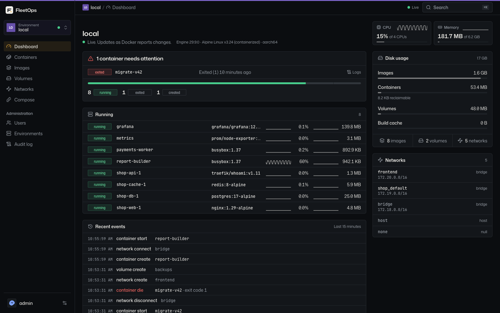
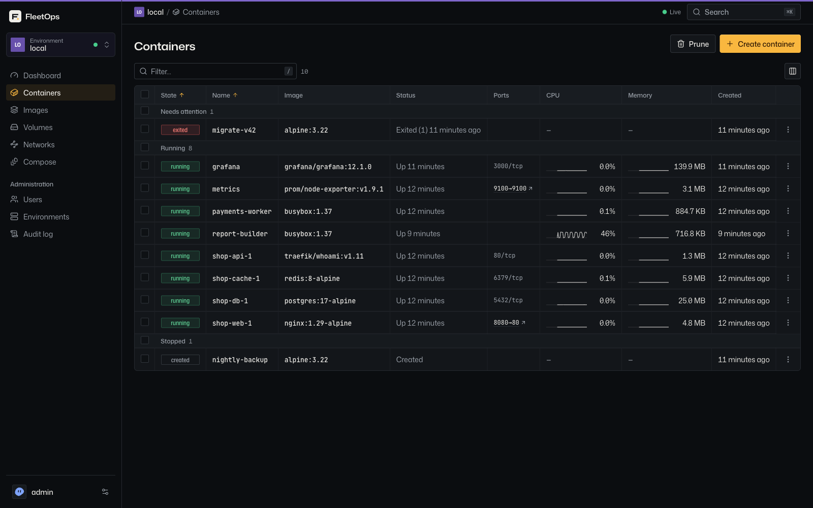
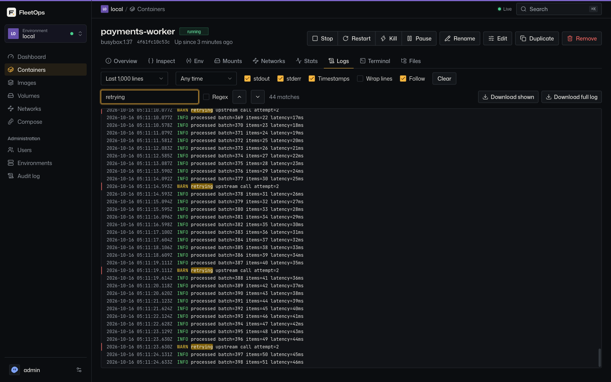
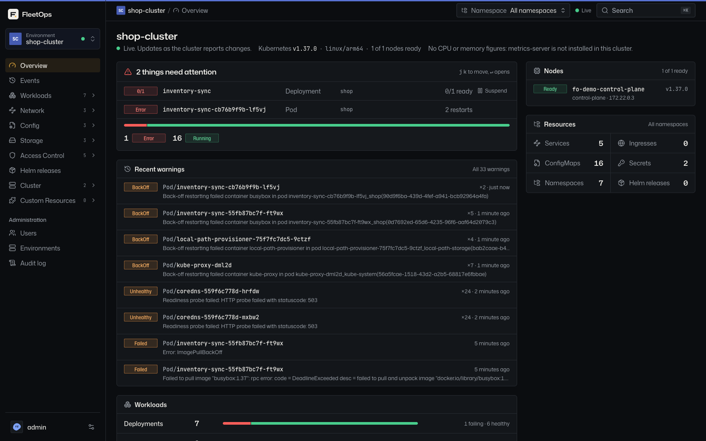
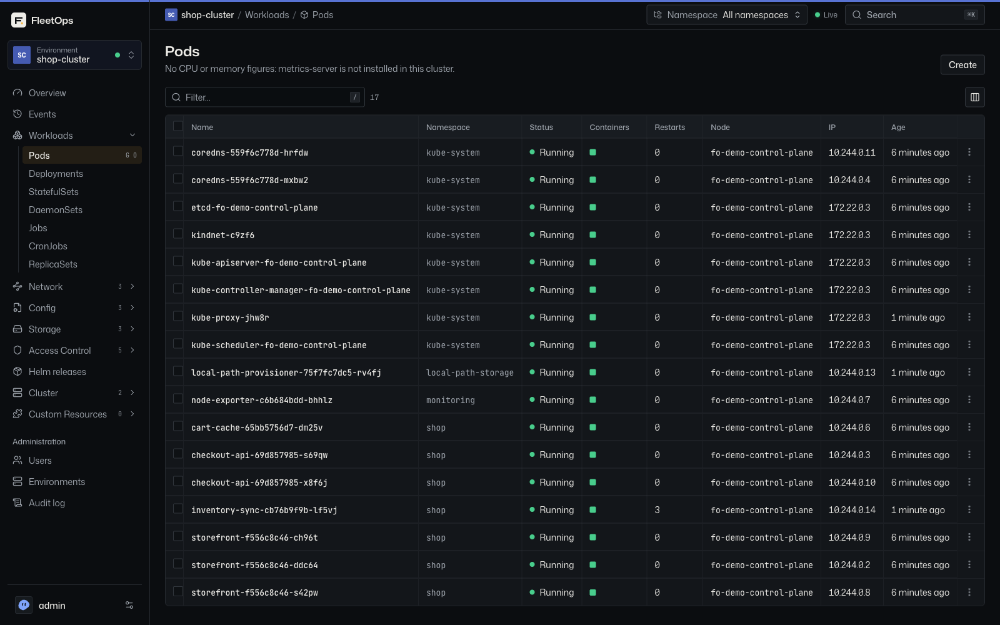

# FleetOps

**A fast, live web UI for Docker hosts and Kubernetes clusters, in one small binary.**

FleetOps is a self-hosted container management platform. It is a single Rust binary with the web UI and a SQLite database built in. Run it next to a Docker or Podman socket and your team can manage containers, images, volumes, networks and Compose projects from the browser. Add more Docker hosts through a dial-out agent, and Kubernetes clusters by kubeconfig or an in-cluster agent, all in the same UI.

It is an open-source alternative to Portainer: roles, Kubernetes namespace scoping and an audit log are free under Apache-2.0, on any number of nodes. See [FleetOps vs Portainer](https://fleetops.pravinb.com.np/portainer-alternative) and the [FAQ](https://fleetops.pravinb.com.np/faq).

[Quick start](#quick-start) · [Features](#features) · [Editions](#editions) · [Kubernetes guide](docs/kubernetes.md) · [Security](#security) · [Contributing](CONTRIBUTING.md)



> **Status: early development (0.x).** Docker, multi-host agents, Kubernetes, Helm and per-environment roles all work today. Expect rough edges and breaking changes between minor versions. Stacks and GitOps are next.

## Why FleetOps

- **Live by default.** Lists and detail pages update from Docker events and Kubernetes watches. There is no polling and no refresh button, and when live updates stop the page says so instead of showing stale data as current.
- **Small and fast.** One static binary of about 17 MB, or a distroless image. CI checks that idle memory stays under 50 MiB on a host with 50 containers.
- **Built for incidents.** A virtualized log viewer that handles 200k lines with search and ANSI colour, and a terminal that never silently starts a new shell. Every exec and every change is audited.
- **Access control included.** Per-environment viewer and operator roles, namespace scoping on clusters, and an audit log are free and Apache-2.0.
- **No telemetry.** FleetOps never phones home.

## Screenshots

<table>
  <tr>
    <td width="50%"></td>
    <td width="50%"></td>
  </tr>
  <tr>
    <td align="center">Containers, with live CPU and memory</td>
    <td align="center">Logs with search, timestamps and ANSI colour</td>
  </tr>
  <tr>
    <td width="50%"></td>
    <td width="50%"></td>
  </tr>
  <tr>
    <td align="center">Kubernetes cluster overview</td>
    <td align="center">Pods across every namespace, updated live</td>
  </tr>
</table>

## Quick start

```sh
docker run -d --name fleetops -p 9000:9000 \
  -v fleetops-data:/data \
  -v /var/run/docker.sock:/var/run/docker.sock \
  --group-add "$(docker run --rm -v /var/run/docker.sock:/s busybox:1.37 stat -c %g /s)" \
  fleets/fleetops
```

Open <http://localhost:9000> and create the admin account. Setup locks if no admin is created within 10 minutes of starting, until the server restarts.

The image runs as a non-root user on `distroless/static` for linux/amd64 and linux/arm64. It reaches the socket through the group that owns it, which `--group-add` grants. That group is read from inside a throwaway container because on Docker Desktop and Colima the socket lives in a VM and its group differs from the one on the host; the same command works on Linux.

> **Docker socket access is root on the host.** Don't expose FleetOps to an untrusted network without TLS (`--tls-bind`), and create the admin account right away.

### Other ways to run it

- **Binary.** Static linux binaries with SHA-256 checksums are on the [releases page](https://github.com/pravinbanjade/fleetops/releases):

  ```sh
  ./fleetops --data ./data --bind 127.0.0.1:9000
  ```

- **From source.** Needs Rust (stable), Node.js 24+ and pnpm 12. See [docs/development.md](docs/development.md).

  ```sh
  git clone https://github.com/pravinbanjade/fleetops.git
  cd fleetops
  make build          # builds the UI, then the release binary with it embedded
  ./target/release/fleetops --data ./data --bind 127.0.0.1:9000
  ```

When the socket isn't at `/var/run/docker.sock` (Colima, rootless Docker, Podman), set `DOCKER_HOST`, for example `DOCKER_HOST=unix://$HOME/.colima/default/docker.sock`. On first start, FleetOps registers a `local` environment if it can reach the socket.

### Add a remote Docker host

1. In **Admin → Environments**, choose **Add environment → Agent on a remote host** and name it.
2. Run the `docker run` command it shows on the remote host. It contains a single-use join token that expires in 15 minutes.
3. The environment shows as online within a few seconds.

The agent dials out to the server, so the remote host opens no port and never exposes its Docker socket. It must reach the server over HTTPS (start the server with `--tls-bind`); plain HTTP is accepted only from the same machine. For a self-signed certificate, mount it into the agent and pass `--ca /ca.pem`. Agent flags: `--server`, `--join-token` (first start only), `--data` (default `/data`), `--docker` (default `unix:///var/run/docker.sock`), `--ca` and `--log`, each with a `FLEETOPS_AGENT_*` variable.

### Add a Kubernetes cluster

In **Admin → Environments → Add environment**, either paste a kubeconfig, or choose the in-cluster agent and run the `kubectl apply` command it gives you. The agent dials out too, so the cluster needs no inbound access and the server never holds its credentials. The [Kubernetes guide](docs/kubernetes.md) covers supported kubeconfigs (including EKS, GKE and AKS), agent access levels and Helm.

## Features

**Docker**
- **Dashboard** with container counts by state, disk usage and host information.
- **Containers:** filter and bulk actions, live CPU and memory sparklines in the list, and detail tabs for Overview, Inspect, Env, Mounts, Networks, Stats, Logs, Terminal and Files.
  - **Logs:** virtualized, keeping the newest 200k lines. Text or regex search with highlighting, stdout and stderr toggles, timestamps, tail and time range, ANSI colours and download. A reconnect or restart resumes without repeating lines.
  - **Terminal:** xterm.js with resize and a choice of shell and user. A dropped connection ends the session rather than silently starting a new one.
  - **Create, recreate with changes** (rolls back if the new container fails to start), and **duplicate**.
- **Images:** pull with layer progress, build from a Dockerfile or tar context with a streamed log, tag, history, inspect, remove and prune.
- **Volumes and networks:** create, inspect, connect and disconnect, remove and prune.
- **Compose projects:** containers grouped by project, with start, stop, restart and down.

**Kubernetes**
- Browse workloads, services, ingresses, network policies, config, storage, RBAC, events and every custom resource the cluster serves, in one namespace or all.
- Live lists and object pages from watch streams.
- *Edit YAML* and *Create*, always as a dry run shown as a diff before anything is written.
- An overview that leads with what needs attention: failing pods, workloads short of replicas, failed Helm releases and nodes not ready.
- Pod and workload logs, terminals, scale, restart, suspend and resume, cordon, and run a CronJob now, one object or a selection at a time.
- CPU and memory from metrics-server.
- **Helm:** releases with history, values and manifest; rollback and uninstall after a reviewed diff; install and upgrade from repositories and OCI registries.

**Multi-host and teams**
- Dial-out agents for remote Docker hosts and clusters, with key rotation and live online/offline state.
- Users with per-environment **viewer** or **operator** roles, optionally limited to some namespaces. See [Access](#access).
- An audit log of every change, every terminal session and every refused action, kept for 90 days by default.

**Interface**
- Command palette (⌘K / Ctrl-K) to jump to any resource or run an action on it; `/` focuses the list filter.
- Dark, light and system themes.
- Values that look like secrets are masked until clicked.

## Editions

| | Community | Enterprise |
|---|---|---|
| License | Apache-2.0 | [FleetOps Enterprise License](ee/LICENSE) plus a subscription |
| Image | `fleets/fleetops` | `fleets/fleetops-ee` |
| Docker, Kubernetes, Helm, agents | ✓ | ✓ |
| Roles and namespace scoping | ✓ | ✓ |
| Audit log (90-day retention) | ✓ | ✓ |
| Audit export (CSV, NDJSON) | | ✓ |
| Teams with shared environment access | | ✓ |
| Custom roles (fine-grained RBAC) | | ✓ |
| SSO (OIDC, LDAP), API tokens, backup | | planned |

The Enterprise image runs as Community until a license is installed: upload it in **Admin → License**, or start the server with `--license-file` / `FLEETOPS_LICENSE_FILE`. Licenses are checked offline. After expiry, Enterprise features keep working for 14 days, then turn off; Community features and data are never affected. A license may cap the number of users: past the cap no new users can be created, and existing users keep working.

Teams come with any Enterprise license: add a user to a team in **Admin → Teams** and they get its environment access, alongside their own. Each grant a user holds, direct or through a team, is checked on its own, so Operator on one namespace plus Viewer on the whole cluster is Operator on that namespace and Viewer everywhere else.

Custom roles come with any Enterprise license too. In **Admin → Roles** an admin builds a role as a grid: a row per kind of resource (containers, images, volumes, networks, stacks; workloads, pods, ConfigMaps, Secrets, networking, storage, Helm releases, everything else) and a column per action (View, Create, Operate, Delete, Shell, Reveal). For example, a "Deployer" can start and restart containers but not delete them or prune volumes. A custom role is given to users and teams on an environment exactly like Viewer and Operator, namespaces included. **Reveal** covers secret material: container env vars and files, Helm values and notes, and the real values of a Kubernetes Secret, which no built-in role shows; every time Secret values are shown it is written to the audit log.

Without a license, teams and custom roles are read-only and keep granting access; removing members, permissions, grants or whole roles always works. Running the Community image on the same data ignores teams and custom-role grants, so access through them stops until you switch back.

Known limits of custom roles: Helm and Compose actions are checked against the Helm and Stacks rows only, not against what a chart or stack creates; Shell reaches whatever the container or pod can read; and *Create* on "everything else" includes Kubernetes RBAC objects, so it can bind a service account to cluster-admin inside the cluster (FleetOps access itself is not widened).

Everything outside `ee/` is Apache-2.0. The `ee/` directory is source-available: you may read, modify and test it, and production use needs a subscription. `make build` builds Community with no Enterprise code compiled in; `make build-ee` builds Enterprise.

## Access

Admins manage users, environments and access, and can do everything everywhere. Every other account works only in the environments an admin grants it, from **Users → Access**:

- **Viewer** reads everything the grant covers: lists, details, logs, stats, events and YAML.
- **Operator** can also change it: start, stop, remove, pull, create, Compose actions, delete, scale, restart, edit and apply YAML, and terminals (a shell counts as a change).

An environment a user has no role on does not exist for them: it is missing from their list and its URLs answer *not found*.

**Namespaces.** A role on a Kubernetes environment can be limited to some namespaces. The user then sees and acts on objects in those namespaces only; *All namespaces* means all of theirs. Of the cluster-wide kinds they can read Nodes, and Namespaces in their list; they cannot change or apply anything cluster-wide. FleetOps enforces this boundary, not the cluster: the agent or kubeconfig keeps its own permissions. A namespace that is deleted stays in the grant, so recreating it restores access. An operator limited to some namespaces can still create pods there with any service account or host access the cluster allows, so give namespace-limited operators only namespaces whose cluster policies (Pod Security, RBAC) you trust.

**Upgrading from a release without roles.** Existing non-admin accounts keep operator access to every environment that existed before the upgrade. A new environment is visible only to admins until access is granted. Refused actions are recorded in the audit log as *denied*.

## Configuration

Configuration comes from CLI flags or environment variables. There is no config file.

| Flag | Environment variable | Default | Description |
|---|---|---|---|
| `--data` | `FLEETOPS_DATA` | `/data` | Directory for `fleetops.db` (SQLite, WAL mode) and TLS material |
| `--bind` | `FLEETOPS_BIND` | `0.0.0.0:9000` | Plain HTTP listen address |
| `--tls-bind` | `FLEETOPS_TLS_BIND` | unset (HTTPS off) | HTTPS listen address, for example `0.0.0.0:9443` |
| `--tls-cert` / `--tls-key` | `FLEETOPS_TLS_CERT` / `FLEETOPS_TLS_KEY` | unset | PEM certificate and key; pass both or neither. When unset, a self-signed certificate is generated and saved in the data directory |
| `--hsts` | `FLEETOPS_HSTS` | off | Send HSTS on HTTPS responses. Enable it only when no client uses the plain HTTP listener, because browsers apply HSTS per host, not per port |
| `--docker-host` | `DOCKER_HOST` | `unix:///var/run/docker.sock` | Docker endpoint for the `local` environment |
| `--helm-binary` | `FLEETOPS_HELM` | unset (off) | The helm that renders charts for install and upgrade: `helm` on PATH or an absolute path |
| `--helm-insecure-repos` | `FLEETOPS_HELM_INSECURE_REPOS` | off | Allow `http://` chart repositories |
| `--license-file` | `FLEETOPS_LICENSE_FILE` | unset | Enterprise only: license file; one uploaded in Admin → License takes precedence |
| `--kube-exec-plugins` | `FLEETOPS_KUBE_EXEC_PLUGINS` | unset (off) | Exec plugins kubeconfig users may run: `default` (aws, aws-iam-authenticator, gke-gcloud-auth-plugin, kubelogin) and extra bare names, comma-separated |
| `--secret-key` | `FLEETOPS_SECRET_KEY` | unset (`<data>/secret.key`) | 32 bytes, base64: seals stored kubeconfigs. Back it up with the database |
| `--log-level` | `FLEETOPS_LOG` | `info` | `tracing` filter, for example `fleetops_api=debug,info` |
| `--openapi` | — | — | Print the OpenAPI document to stdout and exit |

Run `fleetops --help` to see the full list.

**Back up** `fleetops.db` together with the secret key (`<data>/secret.key` or `FLEETOPS_SECRET_KEY`). Without the key, stored kubeconfigs cannot be read.

## Security

To report a vulnerability, see [SECURITY.md](SECURITY.md). Please don't open a public issue.

- **Authentication.** All Docker and Kubernetes routes need a signed-in session, and mutations also need the `X-CSRF-Token` header. Passwords are hashed with argon2id, only hashes of session tokens are stored, and failed logins are rate-limited.
- **Cookies.** Session cookies are `HttpOnly` and `SameSite=Strict`, and `Secure` over TLS. Sessions expire after 7 days idle or 30 days in total.
- **Headers.** Responses send a strict CSP, `frame-ancestors 'none'`, `X-Content-Type-Options` and `Referrer-Policy`, and HSTS when you enable it.
- **Secret masking is display-only.** The API returns values unredacted, and anyone with access can reveal them.
- **Agents.** Join tokens last 15 minutes and work once; the server stores only SHA-256 hashes of tokens and keys. Agent credentials open the tunnel and nothing else. Failed agent connects are rate-limited per address. Agents must use HTTPS unless they connect from the same machine.
- **Trust.** A compromised server is root on every agent host, as it already is on its local socket. Treat the server like the hosts it manages.
- **Reverse proxies.** Agents need TLS all the way to FleetOps: the server does not trust `X-Forwarded-Proto`, so a proxy that terminates TLS and forwards plain HTTP gets `403` for agents unless it runs on the same machine. Either re-encrypt to `--tls-bind`, or pass TLS through (TCP mode). Pass WebSocket upgrades through to `/api/v1/agent/connect`, and keep idle timeouts above 30 s (the server pings agents every 15 s).
- **Container image.** It runs as a non-root user on `distroless/static`, with no shell. Docker access comes only from the socket group you grant with `--group-add`.

## Roadmap

**Done:** core and local Docker · remote hosts through agents · Kubernetes (live lists, YAML editing, custom resources, events and metrics, suspend and resume, workload logs and exec, EKS/GKE/AKS kubeconfigs) · per-environment roles with namespace scoping · Helm releases, install and upgrade · Enterprise audit export, teams and custom roles.

**Next:**
- **Stacks and GitOps:** Compose authoring, a diff before deploy, rollback, and git-backed stacks synced by webhook or polling.
- **Port-forward:** reach a pod's port through FleetOps.
- **Enterprise:** SSO (OIDC, LDAP), API tokens, backup and restore, SIEM forwarding and long audit retention.

## Documentation

- [Kubernetes and Helm](docs/kubernetes.md)
- [Development](docs/development.md): toolchain, make targets, tests and CI
- [Architecture](docs/architecture.md): crates, request pipeline, agent tunnel, REST API and websocket protocol

## Contributing

Bug reports, ideas and pull requests are welcome on [GitHub](https://github.com/pravinbanjade/fleetops). Read [CONTRIBUTING.md](CONTRIBUTING.md) first: commits need a DCO sign-off (`git commit -s`), and new behaviour starts with a failing test.

## License

FleetOps Community is licensed under [Apache-2.0](LICENSE). The `ee/` directory is under the [FleetOps Enterprise License](ee/LICENSE).
